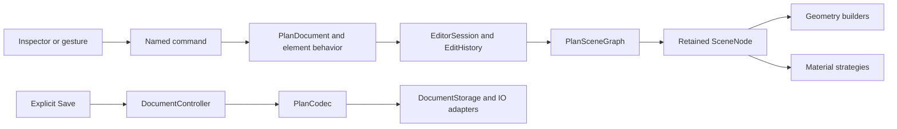

# HView architecture

The editor and the standalone viewer use the same domain, codec, geometry builders, scene graph, materials, and picking code. The editor adds commands, history, selection, persistence, and React views.

## Read the program in this order

1. `src/application/ApplicationRuntime.ts` constructs the collaborators explicitly.
2. `src/domain/model/PlanDocument.ts` owns the immutable document aggregate and element identity.
3. `src/domain/elements/` contains behavioral `Wall`, `Column`, `Room`, `Opening`, and `Furniture` families.
4. `src/application/commands/` contains the supported edit operations.
5. `src/application/EditorSession.ts` commits command results and records before/after mementos.
6. `src/engine/nodes/PlanSceneGraph.ts` reconciles immutable elements into retained scene nodes.

There is one editable authority: the document in `EditorSession`. An element method returns a validated replacement; a command returns a document; the session commits it. Rendered objects, form controls, transport values, and vendor metadata cannot write back into the document.

## Domain behavior and dispatch

`WallRecess` owns niche creation, alignment, cut bounds, split constraints, and inherited surface choices. Its `recessHostId` is the one persisted host relationship. `PlanDocument` validates that host, rehosts clear splits, rejects intersecting splits, and removes dependent recesses when their host is deleted. Recess indexes contain the same immutable instances; rendering and inspectors never infer host ownership from proximity. Legacy raw host aliases are consumed and removed on import.

`Luminaire` validates emission settings. `Shelving` owns shelf count and lids, including the limits used by the schema; its geometry consumes those values. `BasinCabinet` owns basin/carcass proportions. `Door` owns angle clamping/rounding, incremental rotation, and hinge/swing behavior. `SlidingDoor` retains sliding configuration, and `WindowOpening` owns sill/top semantics. Ordinary furniture models remain catalog entries represented by `StandardFurniture`.

`PlanElementFactory` constructs the appropriate class from canonical catalog behavior. `PlanElementVisitor` provides explicit dispatch for serialization, scene-node creation, and inspector presentation. Asset aliases and legacy fuzzy names are resolved at import. Rendering uses canonical recipe identities from one catalog and one geometry dispatch table.

`PlanDocument` enforces global IDs and wall ownership of openings. Hosted openings are stored once in their wall and indexed by the aggregate. Its walls/rooms/columns/furniture collections are immutable derived indexes. Splitting a wall rejects intersecting apertures, preserves opening world positions, recomputes junctions and room relationships, and rehosts related recesses. Columns remain actual `Column` instances; their rectangular extrusion input is a temporary geometry value. Column splitting produces two columns.

Transport interfaces in `domain/model/PlanData.ts` describe codec inputs and detached `toData()` results. They are not another document store. Unknown legacy metadata is frozen and retained for compatibility; recognized top-level collections are removed from that sidecar and regenerated from live elements on legacy export.

## Editing, history, and selection

React and gizmos execute commands such as `TransformFurniture`, `ConfigureLuminaire`, `FinishWall`, and `SplitColumn`. There is no generic mutable furniture patch API. Gizmo movement is a render preview; release commits one transform command. `CommandBatch` applies an operation atomically. A failing command leaves document/history unchanged.

`EditHistory` holds immutable before/after document references. Undo and redo restore those references and reconcile rendering through the same document subscription. Selection is a discriminated ID union, separate from persistent state. Inspector surface targets read this union directly; they are not mirrored through React effects. Surface keys are canonicalized at the codec/entity boundary, so historical case and recess aliases cannot create competing finish values. Inspectors resolve selected IDs against the current document; they do not hold editable copies of selected entities.

## Rendering and resources

`SceneEngine` is the viewport facade. `PlanSceneGraph` owns scene-node lifetimes; `SceneNodeFactory` visits domain elements. Furniture transformations update retained roots. Furniture, wall, and floor finish changes replace materials while keeping geometry. Door angle changes update the retained pivot or sliding leaf. Geometry changes replace the affected node content.

`WallMeshBuilder` owns extrusion/subdivision and UV grouping. `WallTrimsBuilder` owns frames and baseboards. `WallSurfacePalette` owns wall materials and their surface roles. The existing geometry algorithms are retained. `SurfaceMaterialFactory` assembles materials using tile, wood, slat, coating, fabric, and glass strategies with injected canvas creation and seeded procedural texture randomness.

`ResourcePool` reference-counts geometry, materials, and textures. Each node owns a lease; replacement retains new resources before releasing the old lease. Default builder palettes have engine-lifetime leases. Original furniture materials remain owned while a finish override is active. Texture loading refreshes leases and invalidates rendering. Disposing a cached material or texture removes it from the corresponding cache.

`PickRegistry` maps leaf meshes to typed element IDs and surface targets. Both editor and viewer use `PickingController`, with ancestor visibility, material visibility, and foreground clipping checks. Picking does not climb `userData` to discover element identity. `SceneVisibility` tests an opening's actual position when isolating rooms, including doors on long walls shared by several rooms.

`RenderScheduler` sleeps between invalidations. Camera input, orbit changes, gizmo previews, document changes, resize, and texture completion request frames. Active keyboard navigation keeps scheduling frames until release.

## Save and formats

Save is manual. `DocumentController` captures an immutable document and its load generation, deduplicates repeated requests while a save is pending, and acknowledges only that snapshot. A newer edit remains dirty; an imported document cannot be acknowledged by an earlier save. `DocumentStorage` serializes writes and isolates browser, embedded-file, and HTTP adapters. Storage does not reinterpret topology. Its public write operation is `savePlan`; there is no cache-only staging API. There are no edit timers or unload writes.

The saving dialog locks the application before serialization. Viewport controls, navigation listeners, and transform controls are disabled until completion. Failure unlocks the UI and retains dirty state for manual retry.

HView saves use the validated, versioned `schemaVersion: 1` envelope. Imports accept that envelope and historical RemPlanner/normalized documents through the legacy adapter. The **RemPlanner .plan** export action explicitly uses `LegacyPlanWriter`. HTML exports embed the same canonical document and shared runtime code.

Standalone templates are build artifacts in `dist/`, not checked-in application inputs. The development server builds them from current source on demand and invalidates them when source changes. Downloaded editors retain embedded templates, textures, and the tile catalog, allowing offline save/reload and repeated editor/viewer exports without HTTP access.

## Removed predecessors

The old recess snapping helper and renderer proximity searches, the public cache-only save API, the mutable `PlanManagerService`, old parser/exporter, DI container/tokens, rendering-coupled domain hierarchy, universal object inspector, second asset-builder registry, per-entity update channels, and ancestry-based picking helper have been removed. No compatibility manager or synchronization bridge remains in the application.

## Verification

See [../tests/README.md](../tests/README.md) for commands and coverage scope, and [../tests/RESULTS.md](../tests/RESULTS.md) for validation results. Regression checks cover command atomicity, topology, subtype/format round trips, save races, retained geometry/resource ownership, and real browser editing/offline export workflows.
